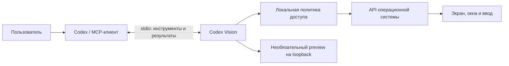

<div align="center">

# Codex Vision

**Дайте Codex доступ к рабочему столу через локальный MCP-сервер.**

Снимки экрана · Окна · Мышь и клавиатура · Accessibility · Локальное наблюдение

[](https://github.com/mikail-tommard/codex-vision/actions/workflows/ci.yml)
[](go.mod)
[](LICENSE)

[Быстрый старт](#быстрый-старт-на-macos) · [Подключение к Codex](#подключение-к-codex) · [Инструменты](docs/tools.md) · [Безопасность](SECURITY.md)

</div>

---

## Что это

Codex Vision — desktop MCP-сервер на Go. Он связывает Codex или другой совместимый MCP-клиент с локальными API операционной системы: агент может запросить экран, найти окно, заполнить доступные поля и выполнить разрешённые действия мышью или клавиатурой.

Проект полезен для работы с приложениями без удобного API, проверки интерфейсов, заполнения форм и выполнения последовательных действий на рабочем столе. Например, можно попросить агента открыть разрешённое приложение, проверить документ в FreeCAD или заполнить несколько полей без отправки формы.

Сервер выполняет захват, проверки и ввод. Модель в подключённом клиенте понимает задачу и выбирает следующие действия. Встроенного LLM, браузерного DOM-драйвера и прямого FreeCAD Python API здесь нет.

## Рекомендуемый цикл агента

`desktop_observe` возвращает окно и нужный кадр одним ответом; UI-контролы запрашиваются через `include_controls:true`, поля — через `include_fields:true`. `desktop_act` принимает ссылки на увиденные контролы или координаты, проверяет цель, выполняет пакет и локально ждёт явное UI-условие. Успешный результат сразу содержит следующий `view_id` — отдельный повторный снимок не нужен.

По умолчанию используется компактный каталог из 13 инструментов и одна текстовая копия метаданных. Для прежнего каталога из 30 инструментов и `structuredContent` задайте `"tool_profile":"full"` в JSON-конфигурации или `--tool-profile full` при запуске. Разрешения и аварийная остановка от профиля не меняются. Для 2048 используйте `wait_for:"change"`; `response` предназначен для двух отдельных визуальных фаз, а не для каждого игрового действия.

[Примеры, проверка результата и восстановление](docs/agent-loop.md) · [Воспроизводимые сценарии и метрики](docs/evaluation.md)

## Возможности

**Vision Coach:** локальные подсказки на экране вместо автоматических ходов. Плавающая панель, светлая/тёмная темы, уведомления по желанию и явная отметка устаревшего совета. Работает через `advisor`; native ввод блокируется до завершения режима. [Запуск и ограничения](docs/advisor.md).

| Задача | Возможности сервера |
| --- | --- |
| Посмотреть экран | Полный экран, монитор или выбранная область; PNG/JPEG и координаты |
| Найти приложение | Список окон, активное окно, переключение на разрешённое окно |
| Работать с интерфейсом | Наведение, клик, перетаскивание, прокрутка, клавиши и Unicode-ввод |
| Заполнять формы на macOS | Подписи полей через Accessibility, заполнение одного поля или пакета |
| Дождаться результата | Локальное ожидание изменений или доступного UI-условия |
| Наблюдать за задачей | Режим на время задачи или непрерывный локальный просмотр |
| Уменьшить лишние кадры | Область внимания, фильтр устойчивых изменений, дедупликация и текстовые результаты |
| Ограничить управление | Режим наблюдения, списки приложений и действий, подтверждения, stop и аудит |

## Как это работает



1. Codex запускает сервер как локальный процесс и общается с ним по **stdio**.
2. Сервер проверяет аргументы, разрешения ОС и локальную политику.
3. Backend получает состояние рабочего стола или выполняет разрешённое действие.
4. Клиент получает структурированный ответ и, если требуется, изображение.

Локальный preview может обновляться без обращений к модели. **Непрерывный захват не означает, что модель непрерывно видит экран:** она получает только результаты явно вызванных инструментов.

## Платформы

| Платформа | Backend и ограничения |
| --- | --- |
| **macOS 13+ · Intel / Apple Silicon** | Quartz / ScreenCaptureKit, Accessibility, управление окнами и ввод. Основное направление текущей разработки |
| **Windows · x64 / ARM64** | Win32, GDI, SendInput. Реализован native backend; работа в интерактивной сессии требует отдельной проверки |
| **Linux X11 · x64 / ARM64** | Локальные X11-утилиты и logind: экран/окна, мышь, drag, клавиши и текст. Пустой Display проверяется через текущую сессию и seat. Нет UI-контролов, app_launch и диалога подтверждения; см. [настройку](docs/platforms.md#linux-x11) |
| **Linux Wayland** | Не поддерживается; полноценного portal-backend пока нет |
| **Mock** | Синтетический экран для разработки и тестов; не управляет компьютером |

Инструменты macOS Accessibility и `app_launch` доступны только на соответствующем backend. Мобильные устройства не поддерживаются. Успешная сборка и unit-тесты не подтверждают работу каждого приложения в реальном GUI.

## Быстрый старт на macOS

Нужны **Go 1.26.5+**, Git и Apple Command Line Tools. Если Apple SDK ещё не установлен, выполните `xcode-select --install`. Первой сборке нужен доступ к Go modules.

```sh
git clone https://github.com/mikail-tommard/codex-vision.git
cd codex-vision
./scripts/build.sh
cp configs/config.example.json config.json
```

Скрипт выбирает архитектуру текущего Go toolchain:

| Компьютер | Бинарный файл |
| --- | --- |
| Apple Silicon | `bin/codex-vision-darwin-arm64` |
| Intel Mac | `bin/codex-vision-darwin-amd64` |

Проверьте разрешения, подставив имя своего бинарного файла:

```sh
./bin/codex-vision-darwin-arm64 --doctor
./bin/codex-vision-darwin-arm64 --request-permissions
```

В **System Settings → Privacy & Security** разрешите **Screen Recording** для захвата и **Accessibility** для управления. macOS может показать сервер или приложение, которое его запускает. После изменения разрешений перезапустите соответствующий процесс. Подробнее: [разрешения macOS](docs/macos-permissions.md).

Пример `config.json` по умолчанию включает **только наблюдение**. Чтобы разрешить ввод, используйте отдельный [assist-профиль](#как-разрешить-управление).

## Подключение к Codex

### Через командную строку

Из корня проекта на Apple Silicon:

```sh
codex mcp add codex_vision -- "$(pwd)/bin/codex-vision-darwin-arm64" --config "$(pwd)/config.json"
codex mcp list
```

На Intel замените `arm64` на `amd64`. На Windows и Linux укажите соответствующий бинарный файл из [инструкции по сборке](docs/platforms.md).

Пути к бинарнику и конфигу должны быть абсолютными. Относительные `audit_file` и `stop_file` разрешаются относительно рабочей директории процесса; для стабильной настройки задайте их абсолютными путями либо используйте `cwd` в TOML.

### Через `config.toml`

Добавьте секцию в `~/.codex/config.toml`, сохранив существующие настройки. При собственном `CODEX_HOME` используйте файл конфигурации в нём.

```toml
[mcp_servers.codex_vision]
command = "/absolute/path/codex-vision/bin/codex-vision-darwin-arm64"
args = ["--config", "/absolute/path/codex-vision/config.json"]
cwd = "/absolute/path/codex-vision"
startup_timeout_sec = 15
tool_timeout_sec = 45
```

Готовый шаблон: [configs/codex-vision.mcp.toml](configs/codex-vision.mcp.toml). Замените пути и архитектуру перед использованием.

Для автоматического добавления секции есть скрипт на Python 3.11+. Он определяет пути проекта и платформу, проверяет наличие бинарника и конфига, сохраняет остальные настройки и отказывается заменять отличающуюся существующую секцию:

```sh
python3 scripts/connect-codex.py --dry-run
python3 scripts/connect-codex.py
```

После регистрации откройте новую сессию Codex. После пересборки сервера или изменения его локального конфига перезапустите MCP-подключение либо Codex: уже работающий процесс не перечитывает эти изменения автоматически.

Синтаксис регистрации и TOML описан в [официальной документации OpenAI о MCP](https://developers.openai.com/codex/mcp).

### Проверка подключения

Попросите Codex:

> Через codex_vision проверь session_status, найди открытые окна и покажи текущий экран. Ничего не нажимай.

Если сервер запущен с `--mock`, клиент получит синтетическое изображение — это тест соединения, а не снимок вашего экрана.

## Как разрешить управление

Создайте `config.json` из [configs/assist.macos.example.json](configs/assist.macos.example.json) вместо observe-примера. В нём разрешён только TextEdit, включены локальные подтверждения и задан конечный бюджет действий. Добавляйте нужные приложения **точными путями executable**.

```json
{
  "mode": "assist",
  "allow": ["window_focus", "mouse_move", "mouse_click", "keyboard_type"],
  "allowed_processes": [
    "/System/Applications/TextEdit.app/Contents/MacOS/TextEdit"
  ],
  "local_approval": true,
  "confirm_each_action": true
}
```

Это фрагмент параметров; полный рабочий профиль находится в примере. `confirm_each_action:false` разрешает обычный ввод без отдельных диалогов в рамках локальной политики. Это осознанное расширение доступа; разрешения ОС, проверка окна и stop продолжают действовать. MCP-вызов не может самостоятельно изменить политику.

Для FreeCAD на macOS добавьте **оба** пути: основной launcher `/Applications/FreeCAD.app/Contents/MacOS/FreeCAD` и GUI-процесс `/Applications/FreeCAD.app/Contents/Resources/bin/freecad`. Для `app_launch` используется первый. Это разрешение на GUI-управление, а не интеграция с Python API FreeCAD.

Полный разбор параметров: [конфигурация и доступ](docs/configuration.md).

## Наблюдение и экономия вызовов

- **Task** — захват на время задачи; при бездействии агента по умолчанию останавливается через 120 секунд.
- **Continuous** — локальный захват до явной остановки или отключения клиента.
- **Preview** — локальная страница, ссылка на которую возвращается как `preview_url`; кадры хранятся в памяти сервера.

Для экономного сценария выберите рабочую область, выполните предсказуемые шаги одним пакетом и дождитесь результата локально. `desktop_batch` возвращает максимум один итоговый кадр; при подтверждённой AX-готовности `result_mode="auto"` может вернуть только текст. Для новой визуальной ситуации, например смены соперника в игре, используйте `result_mode="image"`.

Фильтр сравнивает пиксели и их устойчивость. Он не понимает правила игр и смысл смены страницы. Анимации могут давать ложные сигналы, а краткое полезное изменение может быть отфильтровано. Гарантированный процент экономии подписки не заявляется.

Примеры и диагностика: [наблюдение, ожидание и кадры](docs/observation.md).

## Остановка и приватность

- Начните с `observe`; список разрешённых приложений ограничивает **ввод**, а не содержимое видимого экрана.
- Снимки не записываются сервером на диск и не отправляются им в сторонний сервис. MCP-клиент может передавать полученные кадры своему провайдеру модели.
- Preview открывает HTTP-listener только на loopback. Ссылка даёт доступ к просмотру — не публикуйте её.
- `session_stop` блокирует дальнейший ввод и отменяет текущую операцию. Агент не может снять эту блокировку.
- Для внешней остановки создайте файл по настроенному `stop_file`, например `./scripts/stop.sh /absolute/path/codex-vision.stop`.
- Для восстановления после stop завершите процесс, устраните stop-файл вручную и запустите новую сессию. Старый процесс остаётся заблокированным.

В сервере нет универсального shell-инструмента, скрытого автозапуска или обхода системных разрешений. GUI-ввод всё равно может выполнять серьёзные действия в приложениях; выдавайте доступ только доверенному клиенту. Подробности: [SECURITY.md](SECURITY.md).

## Разработка

```sh
go test ./...
go vet ./...
# Проверка гонок отдельно:
go test -race ./...
```

Тесты используют синтетические экраны и mock-backend. Интерактивные тесты требуют отдельной разблокированной desktop-сессии; см. [проверки и вклад в проект](CONTRIBUTING.md). CI проверяет тесты и сборки, но не заменяет проверку реального UI.

```text
cmd/codex-vision/   Точка входа, CLI и запуск MCP
internal/mcpserver/ MCP-инструменты, схемы и управление операциями
internal/platform/  Native backend macOS, Windows, Linux и mock
internal/observation/ Захват, фильтрация, ожидание и preview
internal/safety/    Локальная политика, бюджеты и аварийная остановка
internal/input/     Валидация клавиш, координат и действий
internal/vision/    Кодирование и подготовка изображений
configs/            Переносимые примеры конфигурации
scripts/            Сборка, тесты, установка и подключение
```

## Если что-то не работает

| Симптом | Что проверить |
| --- | --- |
| Сервер не появился в Codex | `codex mcp list`, абсолютный путь, архитектуру бинарника и перезапуск подключения |
| Нет изображения | Разрешение захвата, разблокированную GUI-сессию и поддержку MCP image content клиентом |
| `process_allowed:false` | Точный путь процесса и `allowed_processes`; видимость окна сама по себе не разрешает ввод |
| Клик вне окна | Активное окно, `source_bounds`, смещение и масштаб картинки; координаты фрагмента не равны координатам рабочего стола |
| Ошибка фокуса / AX | Одну проверку активного окна; при сохраняющейся ошибке прекратить ввод, а не повторять клики |
| Много кадров | `frame.diagnostics`, область внимания и причину завершения ожидания; избегайте лишнего `observation_next` после готового результата |
| Видна старая версия | `session_status.server.version`; пересборка файла не обновляет запущенный процесс |

## Документация

- [Единый цикл агента](docs/agent-loop.md)
- [Оценка и сценарии тестирования](docs/evaluation.md)
- [Каталог MCP-инструментов](docs/tools.md)
- [Настройки и разрешения](docs/configuration.md)
- [Наблюдение и локальное ожидание](docs/observation.md)
- [Сборка для Windows и Linux](docs/platforms.md)
- [Разрешения macOS](docs/macos-permissions.md)
- [История изменений](CHANGELOG.md)
- [Разработка и проверки](CONTRIBUTING.md)
- [Модель безопасности](SECURITY.md)

Проект распространяется по [лицензии MIT](LICENSE). Это независимый проект, не официальный продукт OpenAI.
